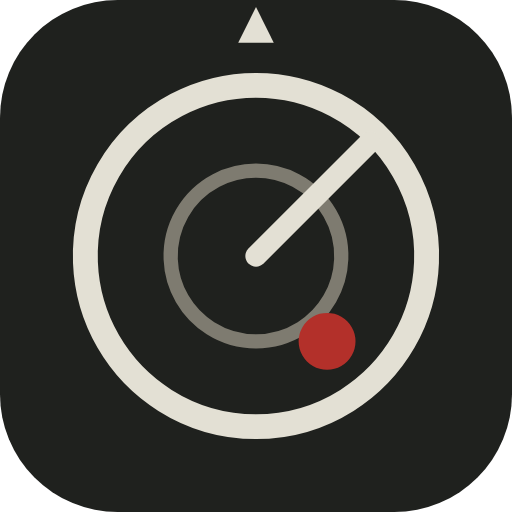
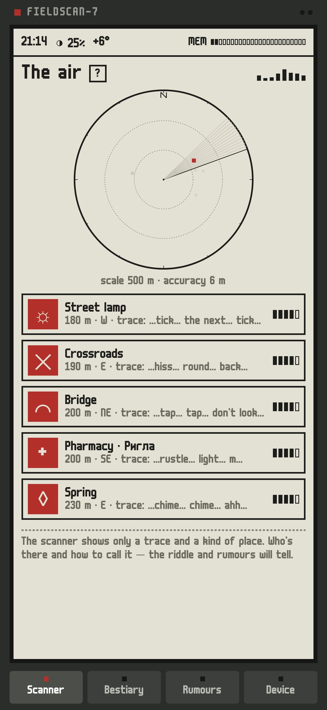
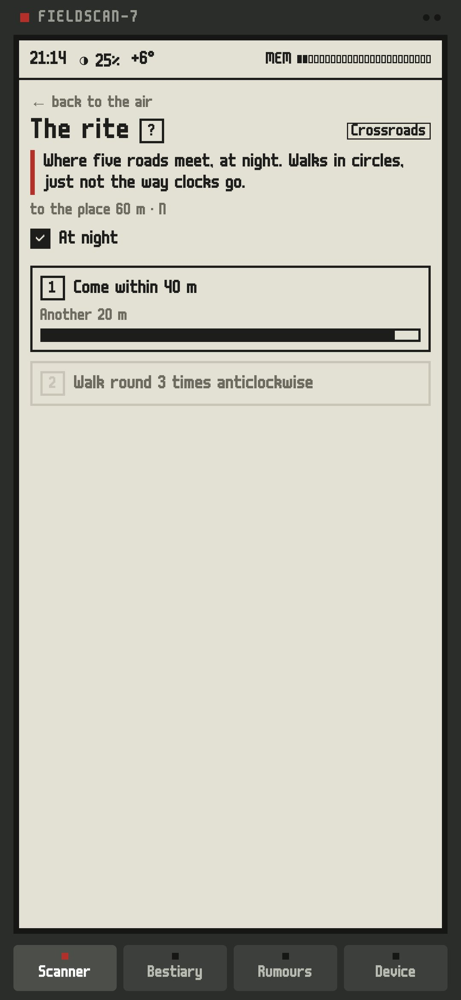
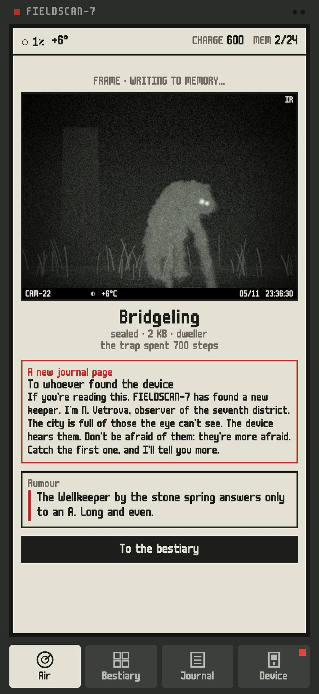
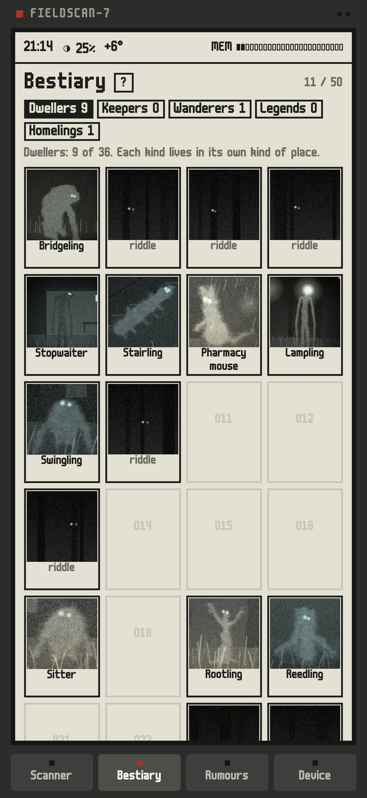

<div align="center">



# Fieldscan (Beta)

### An anomaly scanner for your own city

*Creatures live in the city. Each has its own kind of place and its own way of showing itself. The device hears only a trace; who is there and how to call it out is yours to work out. Stand in the middle of a bridge facing upstream, sing an A by a fountain, meet the dawn at a bus stop, and a trail camera catches what came. Free, no ads, no accounts.*

[](https://github.com/bigdevwhale/fieldscan/actions/workflows/android.yml)
[](https://github.com/bigdevwhale/fieldscan/releases/latest)


[](LICENSE)

**English** · [Русский](README.ru.md) · [Changelog](CHANGELOG.md)

   

**[Download APK](https://github.com/bigdevwhale/fieldscan/releases/latest/download/Fieldscan.apk)** · Android 9+ · beta

</div>

---

## How it works

- **The air.** A round scanner shows traces around you: the kind of place, the distance, the direction, a scrap of signal ("…splash… under… step…") and its strength. The creature itself is never on a map.
- **The riddle.** Each trace opens a riddle in the bestiary: where it waits and what it wants. Riddles are honest: there's always the kind of place and at least one condition.
- **The rite.** One to four steps, each checked by the phone: stand in the middle of a span (GPS), face upstream (compass), keep still (accelerometer), sing a note (pitch only, nothing recorded), blink a letter in Morse with the torch, walk round three times anticlockwise, climb the stairs without stopping, walk along the water in fog, leave the screen alone for a minute.
- **The frame.** When the rite is done, a trail camera fires: a grainy night IR frame with the camera number, the date and the time. The creature is grown from bones, torn by noise, furred and half hidden by the scene; the hour, fog, rain, snow and frost all show in it.
- **Rumours.** Every catch tells about someone else, so the bestiary grows as a web, not a list.
- **Memory and the archive.** The device has 16 KB. Frames in memory wear a step a day until you take them home and hand them in to the archive.

## The bestiary

- **Dwellers** live in kinds of places from OpenStreetMap: bridges over running water, springs and fountains, long stairs, bus stops, pharmacies, street lamps, trees, playgrounds, crossroads of five roads, churches, monuments, towers, piers, underpasses, postboxes, benches, viewpoints, riverbanks.
- **Keepers** live in the district's most-of-all places, found on the phone: the oldest tree, the longest stairs, the longest bridge, the busiest crossroads.
- **Wanderers** come with the weather (MET Norway): fog by the water, rain, a strong wind, frost, snowfall, a full moon.
- **Legends** stand on points of the planet, like a whole-degree confluence.
- **Homelings** settle at your own home.

This beta has 50 creatures. A place always holds the same creature; about four in ten fitting places are empty.

## A manual on every screen

The first time a screen opens, a page of the device's manual explains it; the «?» next to the title opens it again. Back from any screen returns to the air; on the air it asks before switching off. The theme (system, light or a dark night mode of the screen) and the language (system, Russian or English) are set in Device.

## Privacy

Coordinates never leave the phone. The network is used only for the map around you (OpenStreetMap through Overpass, cached for 30 days) and the weather (MET Norway, rounded to ~1 km). The microphone is used only for the "sing a note" step: the pitch is measured and nothing is recorded. No account, no ads, no analytics.

## Build

```
./gradlew assembleDebug                 # app.fieldscan.dev
./gradlew assembleDebug -Pdemo          # app.fieldscan.demo: Zamoskvorechye, Moscow, half a bestiary caught
./gradlew testDebugUnitTest -Prender --tests '*Render*' && python tools/shots.py
```

Debug builds carry a receiver for testing rites at a desk (fake fixes, weather, heading, a tone); see `app/src/debug`.

Map data © OpenStreetMap contributors (ODbL). Weather by MET Norway. Font m6x11 by Daniel Linssen. MIT licence.
