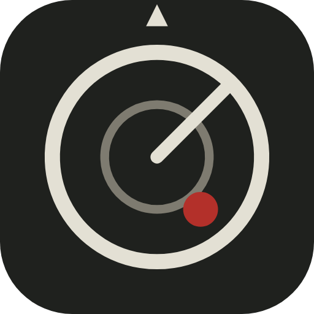
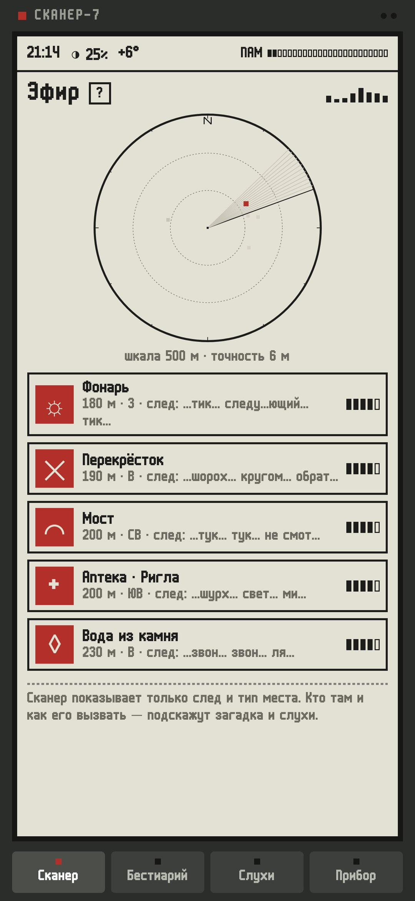
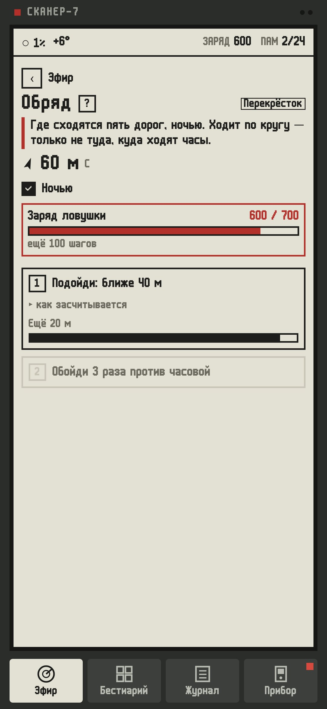
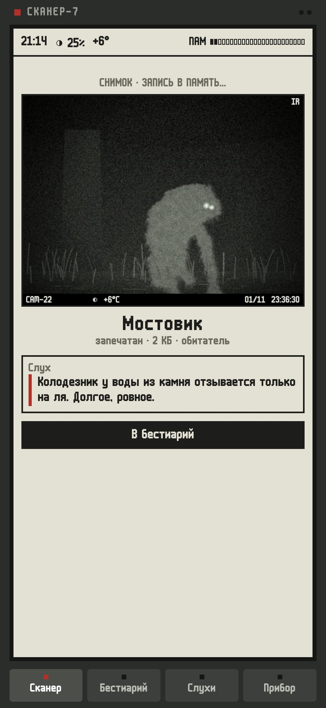
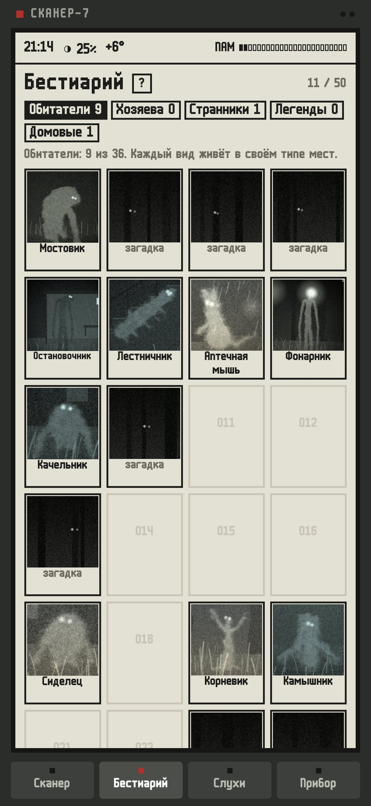

<div align="center">



# Сканер (Beta)

### Прибор для поиска аномалий в твоём городе

*В городе живут существа. У каждого своё место и свой способ показаться. Прибор слышит только след, а кто там и как его вызвать, разгадываешь ты. Встань посередине моста лицом против течения, спой «ля» у фонтана, встреть рассвет на остановке — и фотоловушка снимет того, кто пришёл. Бесплатно, без рекламы и аккаунтов.*

[](https://github.com/bigdevwhale/fieldscan/actions/workflows/android.yml)
[](https://github.com/bigdevwhale/fieldscan/releases/latest)


[](LICENSE)

[English](README.md) · **Русский** · [Изменения](CHANGELOG.md)

   

**[Скачать APK](https://github.com/bigdevwhale/fieldscan/releases/latest/download/Fieldscan.apk)** · Android 9+ · бета-версия

</div>

---

## Как это устроено

- **Эфир.** Круглый сканер показывает следы вокруг: тип места, расстояние, направление, обрывок сигнала («…хлюп… под… ступи…») и его силу. Самого существа на карте нет.
- **Загадка.** Каждый след открывает загадку в бестиарии: где существо ждёт и чего хочет. Загадки честные: в них всегда есть тип места и хотя бы одно условие.
- **Обряд.** От одного до четырёх шагов, и каждый проверяет телефон. Встать посередине пролёта (GPS), повернуться против течения (компас), замереть (акселерометр), спеть ноту (только высота голоса, ничего не записывается), мигнуть букву азбукой Морзе фонариком, трижды обойти против часовой, подняться по лестнице без остановок, пройти вдоль воды в тумане, минуту не трогать экран.
- **Снимок.** Когда обряд выполнен, срабатывает фотоловушка: зернистый ночной ИК-кадр с номером камеры, датой и временем. Существо выращено из «костей», с рваным краем, шерстью и фактурой, и наполовину закрыто сценой. На кадре видно время суток, туман, дождь, снег и мороз.
- **Слухи.** Каждый пойманный рассказывает о ком-то ещё, и бестиарий складывается в сеть, а не в список.
- **Память и архив.** В приборе 16 КБ. Снимки в памяти портятся каждый день, пока их не отнесёшь домой и не сдашь в архив.

## Бестиарий

- **Обитатели** живут в типах мест из OpenStreetMap: мосты над текучей водой, родники и фонтаны, длинные лестницы, остановки, аптеки, фонари, деревья, детские площадки, перекрёстки пяти дорог, храмы, памятники, башни, причалы, подземные переходы, почтовые ящики, скамейки, смотровые площадки, берега рек.
- **Хозяева** живут в «самых-самых» местах района, их находит телефон: самое старое дерево, самая длинная лестница, самый длинный мост, самый большой перекрёсток.
- **Странники** приходят с погодой (MET Norway): туман у воды, дождь, сильный ветер, мороз, снегопад, полнолуние.
- **Легенды** стоят на точках планеты, например на пересечении целых градусов.
- **Домовые** заводятся у твоего дома.

В бета-версии 50 существ. За местом всегда закреплён один и тот же жилец, а примерно четыре подходящих места из десяти пустуют.

## Инструкция на каждом экране

Когда экран открывается впервые, появляется страница инструкции прибора. Кнопка «?» рядом с заголовком открывает её снова. «Назад» с любого экрана ведёт на эфир, а на эфире прибор спрашивает, выключиться ли. Тема (как в системе, светлая или тёмная — ночной режим экрана) и язык (системный, русский или английский) выбираются в «Приборе».

## Приватность

Координаты не покидают телефон. Сеть нужна только для карты вокруг (OpenStreetMap через Overpass, кеш на 30 дней) и для погоды (MET Norway, координаты округлены примерно до километра). Микрофон нужен только для шага «спой ноту»: прибор измеряет высоту голоса и ничего не записывает. Без аккаунта, рекламы и аналитики.

## Сборка

```
./gradlew assembleDebug                 # app.fieldscan.dev
./gradlew assembleDebug -Pdemo          # app.fieldscan.demo: Замоскворечье, полбестиария уже поймано
./gradlew testDebugUnitTest -Prender --tests '*Render*' && python tools/shots.py
```

В отладочных сборках есть приёмник команд для проверки обрядов за столом (подмена координат, погоды, компаса и тон через динамик), см. `app/src/debug`.

Данные карты © участники OpenStreetMap (ODbL). Погода — MET Norway. Шрифт m6x11 — Daniel Linssen. Лицензия MIT.
